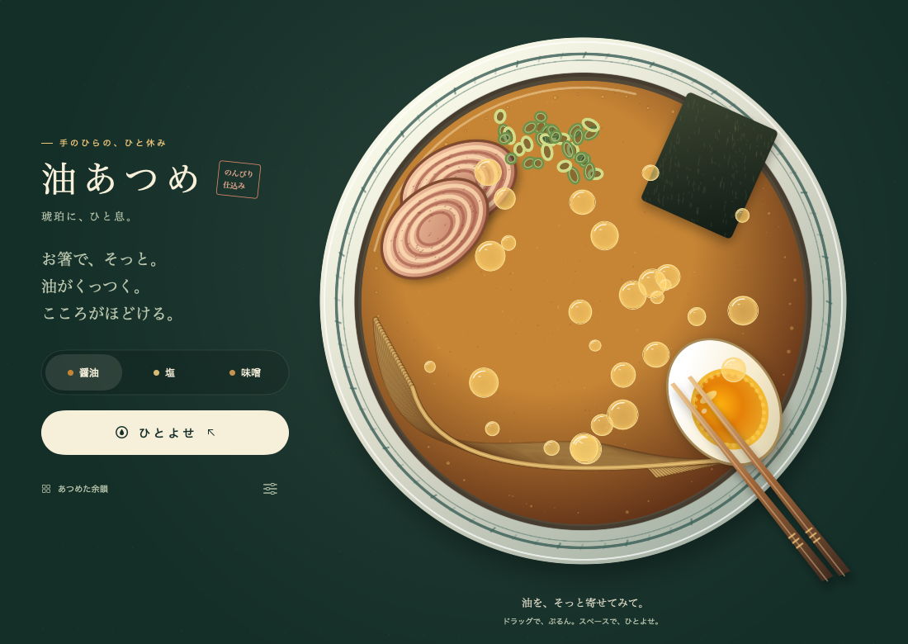

# 油あつめ

**お箸で、そっと。油がくっつく。こころがほどける。**

iPhone・Apple Watch・Macで遊ぶ、時間制限のないラーメンの油集めゲームです。SwiftUIとCanvasで実装し、画像・音声のダウンロードや外部ライブラリは使いません。



## 遊び方

- 油の上を指やマウスでなぞると、箸がついてきて油を引き寄せます。
- 近づいた油は、面積を保ったままぷるんと合流します。
- **ひとよせ**を一度押すだけでも、中央へゆっくり集まります。
- 大きな油はスープに溶け、新しい小さな油が少しずつ現れます。終了条件・失敗・時間制限はありません。
- 醤油・塩・味噌は最初から自由に選べます。
- 遊んでいるうちに「あつめた余韻」に小さな記念が増えます。達成期限や連続ログイン条件はありません。

## Xcodeで開く

1. `OilGarden.xcodeproj` を開きます。外部パッケージの取得やプロジェクト生成は不要です。
2. 実行したいSchemeと端末を選び、Runします。

| Scheme | 対象 | 最低OS |
| --- | --- | --- |
| `OilGarden` | iPhone・iPad（Watchアプリを同梱） | iOS 17 |
| `OilGardenMac` | Macネイティブ | macOS 14 |
| `OilGardenWatch` | Apple Watch（単独実行対応） | watchOS 10 |

実機で動かす場合は **Signing & Capabilities → Team** をご自身のApple Developerチームに設定してください。必要ならBundle Identifierを独自の値に変更します。iPhoneとWatchの識別子を変える際は、Watchの `WKCompanionAppBundleIdentifier` もiPhone側と一致させてください。

Xcode 15以降を想定し、このリポジトリではXcode 27 Betaでビルドを検証しています。署名・App Storeへの配布は含めていません。

## プラットフォームごとの操作

**iPhone** — 片手のドラッグ、タップ、下部の大きな「ひとよせ」ボタン。触覚は弱め、水音は初期状態でオフ。iPhoneでは縦画面に固定しています。iPadでは横画面にも対応します。

**Apple Watch** — ドラッグ・タップに加えてDigital Crownで箸を動かせます。20fpsで描画し、重い液体ブラーを省略。触覚は大きな油が溶けるときだけ。常時表示が暗くなったとき・バックグラウンド・設定画面ではシミュレーションを停止します。音は出しません。

**Mac** — マウス・トラックパッドのドラッグとスペースキー。ウインドウの横幅に応じて縦・横のレイアウトを切り替えます。対応トラックパッドでは触覚フィードバックも使えます。

VoiceOverのダブルタップと「油を寄せる」アクションに対応。OSの「視差効果を減らす」設定では自律的な漂い・油の揺れ・波紋を抑えます。

## 保存とプライバシー

油の位置、スープ、触覚・音の設定、集めた記念を端末内のUserDefaultsに保存します。ドラッグ終了時・バックグラウンド移行時と、遊んでいる間は約8秒ごとに保存します。壊れた保存データは安全に初期化します。

サーバー通信・広告・課金・アナリティクスはありません。端末間の同期は行いません。水音は短い波形を端末で生成し、iPhoneでは消音設定と他アプリの音声を尊重します。

## 開発・検証

```sh
# Xcodeを開発ツールとして選択している環境
swift test

# Mac向けアプリをSwift Packageとして起動する場合
swift run OilGarden

# 署名なしでMac向けビルド
xcodebuild -project OilGarden.xcodeproj -scheme OilGardenMac \
  -destination 'platform=macOS' CODE_SIGNING_ALLOWED=NO build
```

`Sources/OilGardenCore` はUIに依存しない油のシミュレーションです。合流の面積保存・重心・ドラッグ・選択の継承・長時間動作・保存の検証・Crown入力・中断復帰をテストします。

`Sources/OilGardenApp` は描画・各端末のUI・保存・音と触覚を担当します。静的なラーメン画と動く油を分け、具材は拡大しても劣化しない手続き描画にしています。

`Tools/generate_project.py` はXcodeプロジェクトの再生成用です。ターゲット設定を手動で変えた後に実行すると上書きするため、通常の開発では実行不要です。

`Tools/RenderPreview.swift` はMac上でプレビューと原寸アイコンを描画する開発用ツールです。プレビュー画像はアプリの同じSwiftUIビューを使っています（実機スクリーンショットとは異なります）。

検証結果と実機で確認すべき項目は [VALIDATION.md](VALIDATION.md) に記載します。
